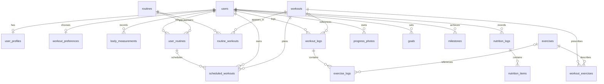

# Fitworld database contract

The proposal needs persistent accounts, fitness preferences, routines, completed or partial workouts, nutrition, progress pictures, and goals. This initial SQLite schema covers those entities; this branch implements the account and onboarding endpoints. The remaining feature endpoints belong to the team's next work.

SQLite is built into Python and can also be accessed from C++. Flask serves HTML/CSS/JavaScript and a small JSON API. No external database service, frontend build, or C++ toolchain is needed to run this contribution. A teammate can add a C++ service behind the same API boundary if the team chooses.

## Apply the schema

Run `python -m flask --app fitworld init-db` after installing `requirements.txt`. The database lives at `instance/fitworld.sqlite3`. Each SQL file in `fitworld/migrations/` is applied once, in filename order, and tracked in `schema_migrations`. Each migration runs in a transaction. Re-running `init-db` preserves accounts and history.

Before this initial branch is shared, `001_initial.sql` is the initial schema definition. After teammates start using it, add a new migration such as `002_add_equipment_preferences.sql` rather than editing an applied file. The runner is intended for one developer process at a time.

Every connection must execute `PRAGMA foreign_keys = ON`. `fitworld.db.get_db()` does so automatically. This is also required for command-line SQL tools and any future C++ connection. See [SQLite's foreign key documentation](https://www.sqlite.org/foreignkeys.html).

## Relationships



| Tables | Purpose and rules |
| --- | --- |
| `users` | Case-insensitive unique email, display name, salted password hash, account creation and onboarding completion timestamps. Password hashes never leave the backend. |
| `user_profiles` | One row per user: age, current weight in kg, preferred display unit, experience, and current weekly exercise frequency. Age 13–120 and weight 20–400 kg are input bounds for this prototype, not personalized fitness advice. |
| `workout_preferences` | One row per user: primary goal, training location, desired days per week, and minutes per workout. A preference does not automatically select a routine. |
| `body_measurements` | Weight history, one reading per user per UTC date. Saving the baseline upserts today's reading and updates current profile weight in the same transaction. |
| `exercises`, `workouts`, `workout_exercises` | Shared catalog with ordered exercises, suggested sets/reps/time, intensity 1–10, and estimated workout duration. Catalog initially empty. |
| `routines`, `routine_workouts` | Reusable weekly plans. Days use ISO weekday numbers: Monday = 1, Sunday = 7. Week numbers start at 1. Future writers must check week numbers against `routines.duration_weeks`. |
| `user_routines` | User enrollment history. A partial unique index permits at most one `active` routine per user; mark the old one `replaced` before adopting a new one, in one transaction. |
| `scheduled_workouts` | Calendar dates for planned, completed, or skipped workouts. Optional enrollment is checked with a composite foreign key so it must belong to the same user. Dates are explicit rather than derived from the current routine. |
| `workout_logs`, `exercise_logs` | Completed and partial workout history, actual reps/time/load, muscle groups, estimated calories, and notes. Snapshot names survive catalog edits or deletion. Logs may exist without a scheduled workout. |
| `nutrition_logs`, `nutrition_items` | Manual or photo meal entry, servings, and per-serving calories/macronutrients/sodium. Multiply each nutrient by servings when aggregating. `NULL` means unknown nutrient; zero means known zero. Photo analysis is not implemented. |
| `progress_photos` | Private storage keys and dates. Upload, authorization, retrieval, and removal of actual images require future endpoints. Do not serve these from `static/`. |
| `goals`, `milestones` | Dated numeric or custom goals and achieved milestones. A selected onboarding goal is a preference; no fabricated milestones or workout history are inserted. |

## Ownership and integrity

- Get the acting user from the authenticated session. Never trust a `user_id` in a request body. The onboarding API intentionally ignores additional request keys.
- Scope every query for private records to that user. For an exercise or nutrition item, check ownership through its parent log. Foreign keys validate relationships; they do not replace endpoint authorization.
- Deleting a user cascades their private SQL rows and nested logs. A future deletion endpoint must separately remove actual photos from private storage. There is no account-deletion endpoint in this branch.
- Catalog entries referenced by workout or routine prescriptions are restricted from deletion. Historical logs keep names and permit catalog references to become `NULL`.
- Removing a routine enrollment deletes its scheduled rows. Preserve historical enrollment rows by changing their status. Actual workout logs are independent and remain intact.
- SQL `CHECK`, `UNIQUE`, and foreign key constraints cover enum values, numeric ranges, ordering, one active routine, and relationships. A trigger prevents marking an existing account complete before its profile and preferences exist. Future SQL writers must preserve that onboarding state and validate date formats; SQLite stores dates as text.
- Store mass as kilograms, duration as seconds in actual logs, plan length as minutes, and sodium as milligrams. Timestamps are UTC. The current onboarding weight history uses UTC dates; future workout and meal endpoints should accept an explicit user-local calendar date for their date columns.
- Weight and age remain private account data. Profile data is stored in the local SQLite file, not in browser storage or the signed session cookie. The cookie carries an account ID, CSRF token, and expiry metadata.

## API handoff

All responses are JSON. Read `GET /api/session` first. Include its `csrf_token` in the `X-CSRF-Token` header on every write, including registration, login, and logout. Keep the session cookie and replace your CSRF token when a response returns a new one.

| Method | Endpoint | Body / result |
| --- | --- | --- |
| GET | `/api/session` | `{ "user": null or user, "csrf_token": "…" }`. Authenticated user includes `profile` and `preferences`, each nullable until saved. |
| POST | `/api/register` | `display_name`, `email`, `password`. Creates an incomplete account, signs it in, returns user and rotated CSRF token; HTTP 201. |
| POST | `/api/login` | `email`, `password`. Returns user and rotated CSRF token. |
| POST | `/api/logout` | Empty JSON object. Clears session; returns `user: null` and a fresh token. |
| PUT | `/api/onboarding/profile` | `age`, `weight`, `unit_system` (`metric` or `imperial`), `experience_level`, `current_workouts_per_week`. Accepts full step data; converts weight from lb when imperial. |
| PUT | `/api/onboarding/preferences` | `primary_goal`, `training_location`, `target_days_per_week`, `session_minutes`. Requires baseline first. |
| POST | `/api/onboarding/complete` | Empty JSON object. Requires both steps; sets completion timestamp once. Safe to retry. |

Successful onboarding writes return `{ "user": { … } }`. Updates after completion remain supported. A returning incomplete user resumes the first unsaved step. The frontend's final screen is the integration point for the future Home page; it does not generate a workout plan.

Validation returns HTTP 422 with `{ "error": "Check the highlighted fields.", "fields": { "age": "…" } }`. Authentication failures return 401, CSRF failures 403, and conflicts or out-of-order steps 409. Malformed JSON returns 400. Registration and login require 8–128 and 1–128 password characters respectively; new passwords use Werkzeug's salted scrypt hash.

## Query examples for teammates

Use placeholders bound by your database client. `:user_id` must come from the session. Avoid joining raw workout rows to raw meal rows when computing daily totals; aggregate separately to prevent multiplying both counts.

```sql
-- Calendar and progress: completed/partial workouts on a selected date.
SELECT id, workout_name, status, duration_seconds, estimated_calories
FROM workout_logs
WHERE user_id = :user_id AND performed_on = :selected_date
ORDER BY started_at;

-- Daily nutrition. Unknown nutrient totals should be marked as incomplete in UI.
SELECT SUM(i.servings * i.calories_per_serving) AS calories,
       SUM(i.servings * i.protein_g_per_serving) AS known_protein_g,
       SUM(i.protein_g_per_serving IS NULL) AS items_missing_protein
FROM nutrition_logs AS n
JOIN nutrition_items AS i ON i.nutrition_log_id = n.id
WHERE n.user_id = :user_id AND n.consumed_on = :selected_date;

-- Upcoming calendar, including any alternative standalone workouts.
SELECT s.id, s.scheduled_on, s.status, w.name, w.estimated_minutes
FROM scheduled_workouts AS s
JOIN workouts AS w ON w.id = s.workout_id
WHERE s.user_id = :user_id AND s.scheduled_on BETWEEN :starts_on AND :ends_on
ORDER BY s.scheduled_on, s.id;

-- Actual exercise performance, scoped through the owning workout log.
SELECT e.exercise_name, e.set_number, e.reps, e.load_kg, e.duration_seconds
FROM exercise_logs AS e
JOIN workout_logs AS w ON w.id = e.workout_log_id
WHERE w.user_id = :user_id AND w.id = :workout_log_id
ORDER BY e.id;
```

The application follows Flask's [SQLite connection pattern](https://flask.palletsprojects.com/en/stable/patterns/sqlite3/) and [account hashing/session pattern](https://flask.palletsprojects.com/en/stable/tutorial/views/). This is a local class-project baseline. Public hosting still needs a production WSGI server, HTTPS with `FITWORLD_HTTPS=1`, a managed `FITWORLD_SECRET_KEY`, login rate limiting, and an account recovery/email-verification design.
