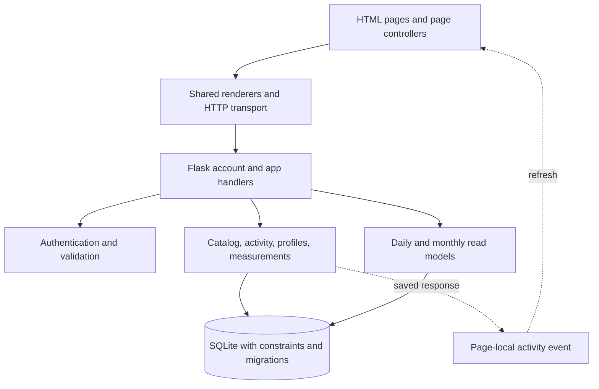

# Design patterns and code-quality review

Reviewed application baseline: `5dd70b4` (including the team's exercise migration and diagrams). The comparison is `git diff 95a4000...5dd70b4`, covering the application since the initial README. The original proposal and the rules in `docs/integration.md` are the requirements sources. There was no existing repository formatter, CI workflow, or separate coding-standard file at that baseline.

## Standards review

The independent standards review found one documented-rule breach and three design concerns:

| Finding at the baseline | Consequence | Resolution in this branch |
| --- | --- | --- |
| Profile weight writes used UTC `date('now')`, unlike the documented local-date policy. | A check-in could appear on the wrong day or overwrite another reading. | Shared measurement writes; explicit local dates; metadata-only updates preserve the latest weight. |
| Exercise names had case-sensitive identities across the seed data and migration 003. | Four case-only duplicate groups could fragment prescriptions and benchmarks. | Additive migration 004 reconciles references and adds a `NOCASE` unique index. Seeding uses the same lookup policy. Existing logged names and muscle snapshots are preserved. |
| Onboarding and app pages duplicated HTTP/CSRF/timeout handling. | A transport change required coordinated edits and could produce inconsistent errors. | Both use the side-effect-free `static/js/http.js` transport. Page-specific session and navigation behavior stays in the callers. |
| No automatic quality gate or formatting agreement. | Contributions could merge without tests or consistent readable formatting. | Pinned development formatters, shared test fixtures, browser-independent transport tests, and a GitHub Actions workflow. |

The last three are design/integration judgments rather than violations of a previously agreed formatting standard. The most significant standards issue was the measurement-date/write policy; it is covered by regression tests.

## Spec review

The independent behavior review found four issues:

| Requirement or contract | Baseline problem | Resolution in this branch |
| --- | --- | --- |
| Explicit local dates; editable personal information | Profile edits always wrote a UTC-dated weight and could replace a saved check-in with stale form data. | `profiles.py` separates metadata edits from weight intent; `measurements.py` synchronizes dated readings and the current profile in a transaction. |
| Maintainable, long-term routines | After its four-week schedule ended, an enrollment remained selected and the UI disabled selecting the same routine. | Read models expose `ends_on` and `is_finished`; the UI permits restarting. A new enrollment keeps the old schedule and marks the finished enrollment completed. |
| Search for specific exercises | Newly contributed exercises outside starter workouts were invisible to workout-only search. | Authenticated `/api/exercises` and the exercise-guide section search all shared definitions without inventing workout prescriptions. |
| Historical workout details remain stable | When actual sets were omitted, past muscle groups were derived from current catalog prescriptions. | Additive migration 005 introduces a muscle snapshot. New logs capture guide/recorded-set metadata at write time. Legacy logs without recorded sets remain unknown rather than borrowing today's guide. |

Photo analysis/uploads and goal/milestone generation were already declared future scope. They are not new failures of this review. The highest behavior risk was overwriting a weight check-in; the current onboarding client now sends explicit weight intent.

Review totals at the baseline: **Standards: 4 findings; Spec: 4 findings**, with overlaps between the two axes. All identified defects and design concerns above are addressed in this branch. This is a reviewed course-project baseline, not a guarantee that no defects remain.

## Patterns actually used

These names describe existing behavior. The project does not add inheritance hierarchies or repository interfaces just to demonstrate patterns.

| Pattern or technique | Where and how it is used | How it helps change |
| --- | --- | --- |
| **Application Factory** | `create_app()` in `fitworld/__init__.py` assembles configuration, blueprints, request hooks, and error handling. Tests create independent application instances with temporary databases. | Configuration and startup changes have one assembly point; tests do not depend on a single global application. This is an application-factory function, not a GoF Abstract Factory hierarchy. |
| **Decorator** | `authenticated` and `onboarded` wrap handlers with session and onboarding checks. The CSRF hook protects writes across blueprints. | A shared access rule changes once rather than being copied into each feature. |
| **Dependency Injection** | Catalog, activity, profile, measurement, and report functions receive their SQLite connection and acting user ID/data. The database module manages the request-scoped connection: `get_db()` creates/reuses it and `close_db()` closes it at teardown. | Tests exercise the real SQLite implementation in temporary files. Database access can be reorganized behind these interfaces without changing page rendering. A different SQL engine would still require its own implementation and migrations. |
| **Transaction Script / explicit transactions** | `log_workout`, `select_routine`, and `save_profile` perform each complete business operation in a transaction. `upsert_measurement` documents that its caller owns the transaction. | Changes to logs/schedules or profiles/measurements commit together. Transaction ownership is explicit; helpers do not silently commit an outer operation. |
| **Layered modules / HTTP adapters** | `app_api.py` converts requests into calls to catalog/activity/report modules. Templates and JavaScript compose the returned data. Account-specific session/authentication behavior remains together in `api.py`. | A page change can stay in its renderer; a calculation change can stay in its report; an account rule can stay in the account feature. This is MVC-style separation without ORM model classes. |
| **Read-model separation** | `activity.py`, `profiles.py`, and `measurements.py` write state; `reports.py` and `progress.py` produce daily/monthly views. Home and Progress share the daily report. | One change to serving totals or workout summaries fixes both pages. This is lightweight command/query separation on one database, not a distributed CQRS system. |
| **Observer / publish-subscribe** | `activityChanged()` dispatches a `fitworld:activity` DOM event after successful writes. Page controllers subscribe and refresh their relevant data. | The shared log dialog does not need to know how Home or Progress renders its results. Events are page-local, not a server bus or cross-tab synchronization mechanism. |
| **Template inheritance and composition** | Pages extend `app_base.html`; `_workout_dialogs.html` is included where needed. Shared CSS tokens and rendering functions provide consistent controls and cards. | Navigation, dialog, and accessibility changes can be made centrally. This is template reuse rather than a GoF Template Method class hierarchy. |
| **Table-driven configuration** | `GOAL_CATEGORIES`, nutrient metadata, and database catalog rows describe choices consumed by shared logic. | New guides are data changes rather than new page branches. New enum values or nutrient columns still require an explicit migration, validation, and presentation decision. |
| **Forward-only migrations and immutable snapshots** | Numbered migrations extend the schema; completed logs retain names, actual values, and muscle metadata. | Teammates can add fields/catalog definitions while keeping existing users and historical records meaningful. Applied migrations stay unchanged. |

The project deliberately does **not** claim a Repository/Strategy/Singleton/State class pattern. There is one SQLite implementation, scoring is a function, connections are request-scoped, and onboarding is an explicit workflow. Add another abstraction when a real second implementation or behavior needs it.

## Architecture at a glance

## Designing the next change

- **New exercise:** add a new migration with a case-insensitive identity check. The exercise-guide reader discovers it automatically. A workout prescription is a separate explicit decision.
- **New profile field:** add the schema/validator and update `profiles.py`; metadata edits must not create a weight check-in. The current client sends `record_weight` and a local `measured_on` date.
- **New historical detail:** capture it when logging. Do not fill missing old history from mutable current definitions. Keep unknown values explicit.
- **New progress calculation:** change the relevant read model and cover a worked example through its HTTP response. Home and Progress share daily totals; keep their aggregate queries independent to avoid multiplying rows.
- **New UI interaction:** use shared transport and form feedback. Emit `fitworld:activity` only after a successful save; keep page refresh/navigation policy out of the transport.
- **Second data store or recommendation algorithm:** introduce a new adapter only when it exists. Current module interfaces provide the seam; empty interfaces and speculative class hierarchies would add work now.

## Practical limits

The catalog seed still uses names as natural keys; a future catalog administration/import feature should introduce stable slugs before treating renames as identifiers. Existing profile clients that omit the optional date retain the legacy UTC fallback; callers should send `measured_on` and explicit `record_weight` intent. Historical muscle groups that were never captured cannot be reconstructed reliably.

The app is designed for the current small team and local SQLite deployment. Larger datasets may warrant bulk-loading some catalog/report queries and pagination behind their existing interfaces. Public hosting requirements remain in `database.md`; this review does not implement external photo services or account recovery.

## Verification after the fixes

- All 50 Python tests pass on Python 3.10 and 3.14, including the new migration and behavior regressions.
- All 5 JavaScript transport tests pass; JavaScript syntax and Python/template/JavaScript/CSS formatting checks pass locally.
- Browser checks cover signup through the shared transport, standalone Bench Press discovery, restarting a finished routine, and a stale age/unit edit preserving a newer 73 kg check-in on the explicit local date.
- Home, Suggested Workouts, and Progress load without page errors or horizontal overflow at 375 and 1440 px.
- Both focused independent re-reviews found no new actionable P1/P2 issues in the fixes. The GitHub Actions workflow is configured; its first remote run will occur after this branch is pushed.

The browser checks used an isolated temporary database, which was removed afterward. Existing local application data was not migrated or changed during this review.
